# MonkeyTax — Visual Case Gallery

Every observable state of the extension, captured end-to-end in a real
Chromium/Edge browser with `dist/` loaded unpacked via
`node scripts/capture-screenshots.mjs`. Badge content is produced by the
actual content script running against per-platform fixture DOMs served
at the `gemini.google.com`, `chatgpt.com`, and `claude.ai` origins
(including the Gemini `You said …` duplication quirk), so each
screenshot reflects the true extraction → classification → calculation →
render pipeline with **2025/2026-calibrated coefficients** (output
tokens carry a ~5× prefill-to-decode energy ratio, and every figure is
rounded into everyday visuals — sips, shot glasses, phone charges).

> Regenerate everything: `npm run build && node scripts/capture-screenshots.mjs`
> Refresh the PDF from this document: `npm run export:showcase`

---

## 1. Intent tiers — collapsed icon widgets

Every badge is a **centered pill** of compact visual widgets, collapsed by
default and free of walls of text (copy rule: zero em/en dashes everywhere).
INFORMATIVE shows `[💧 ~2 sips] [💡 4m lamp] [⚡ 2× web search] [▼]`.
Roast tiers are **instant regret**: warning-red styling and the full
punchline on one line, visible with zero clicks —
`[🔥] [Headline. tail sentence…] [N× search chip] [▼]` — ending in a
conversational money line, then `[▼]` (the drawer adds only numbers, never
a second helping of the joke). Chevron toggles the drawer (§2).

### 1.1 `POLITE` — roast tier

**Prompt:** `Thanks` — the red roast pill delivers the whole joke
instantly: *"Being polite to a toaster: You just evaporated ~2 sips of
water for good manners. A thumbs-up emoji on your keyboard would have
cost zero energy."*

### 1.2 `GREETING` — roast tier

**Prompt:** `Good morning!` — zero-question openers roasted on sight:
*"Woke up a billion-dollar server cluster just to say hi with zero
question attached."*

### 1.3 `LAZY_RETRY` — roast tier

**Prompt:** `fix it` — zero-context rage-commands ("try again", "???")
are caught only after the technical guardrails pass, e.g. *"'Fix it' is
not a prompt. Making the AI guess what broke burned 2 min of lamp
power."*

### 1.4 `SIMPLE_MATH` — roast tier

**Prompt:** `tell me how much is 7777+998` — natural-language math is
caught by the classifier ("what is…", "calculate…", "tell me how much
is…", "solve…" prefixes all fold into SIMPLE_MATH). Collapsed pill shows
the full punchline, e.g. *"Burned enough power to charge 10% of your phone
for grade-school math. Your phone literally has a calculator app sitting
right there."*

### 1.5 `QUICK_SEARCH` — roast tier

**Prompt:** `capital of france` — ultra-short factual lookup roasted
with lines like *"A whole data center drank ~2 sips of water just to
Google something for you."*

### 1.6 `INFORMATIVE` — neutral plain-language readout (~90 % of traffic)

**Prompt:** `Write a TypeScript debounce function` — pure icon widgets:
*`💧 ~2 sips` `💡 4m lamp` `⚡ 2× web search`* with no prose at all.

### 1.7 `INFORMATIVE` + extended thinking — 2.0× reasoning multiplier

**Prompt:** `Prove that the sum of two even numbers is even` (reasoning
UI present) — same template, every figure carries
`REASONING_MULTIPLIER = 2.0`.

---

## 2. The expandable accordion drawer

Clicking a badge opens its details; clicking again closes them.
Gemini and ChatGPT use an inline accordion. Claude uses a bounded native
popover instead: its virtualized message rows keep exactly the same
height, and opening details never calls `scrollIntoView`. The badge is
inserted before the message action bar, and the drawer is positioned
above the actual composer boundary. Escape, outside clicks, scrolling,
or resizing dismiss it. Its document listeners exist only while open.
The drawer leads with **in-line segment meters** and icon visuals, then
the details the collapsed pill hides:

- **Energy meter** — 4-segment battery scaled against the 0.3 Wh web
  search, tagged `💡 Nm desk lamp` (or laptop-load seconds).
- **Water meter** — 4-segment glass bar with discrete `🥛` icons and the
  everyday visual (`~2 sips of water`).
- **Cooling breakdown** — *Scope 1 · Direct towers* (on-site
  evaporation: `2 ml + 2 ml per 1k output tokens`) and *Scope 2 · Grid
  water* (off-site thermoelectric: `5.0 ml per Wh`).
- **Plain-language token line** (neutral tiers) and a rotating line from
  the Reddit hardware-crisis roast bank. Roast tiers open with the
  **complete punchline, fully wrapped**: the collapsed pill can
  ellipsize on narrow viewports, so the drawer guarantees the whole
  joke is readable after the click.
- **Citation link** — opens the scientific modal (§4).

Roast drawer after click (full punchline, wrapped):

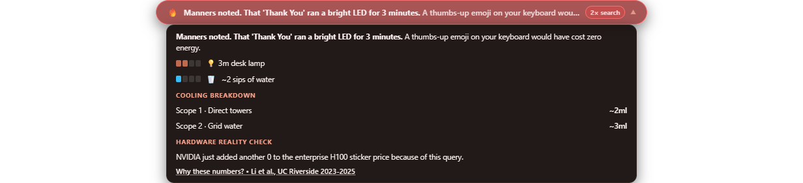
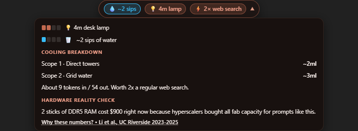
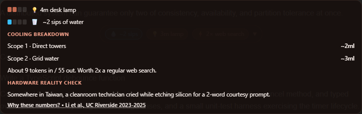

Fixed-composer regressions at desktop, compact-window, and mobile sizes
assert unchanged scroll position, scroll height, and badge height on
open; a clear composer boundary; dismissal on Escape and scroll; and
preservation of an unsent composer draft.
The collapsed Claude badge also uses a local stacking level rather
than the extension's global overlay z-index. An additional regression
deliberately scrolls the pill behind the fixed composer and verifies
that the composer wins pointer hit-testing and receives input focus.
The test scroll panel is not a fixed-position stacking context, which
would otherwise mask the overlap seen on the real site.

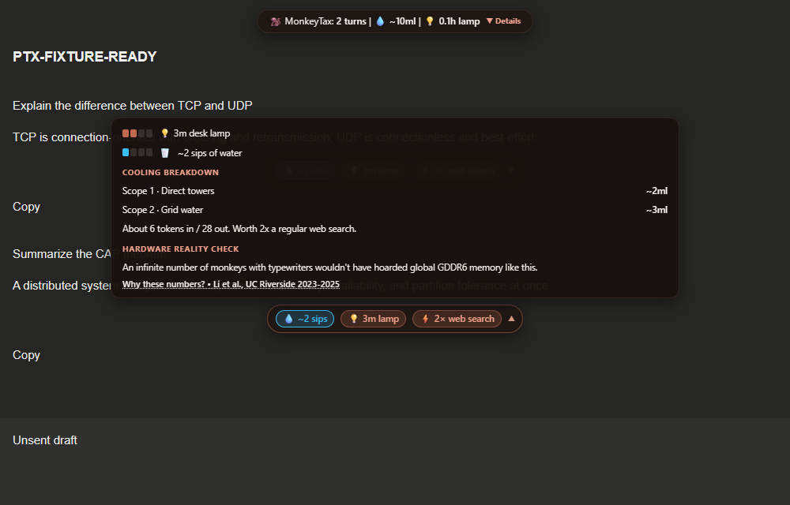
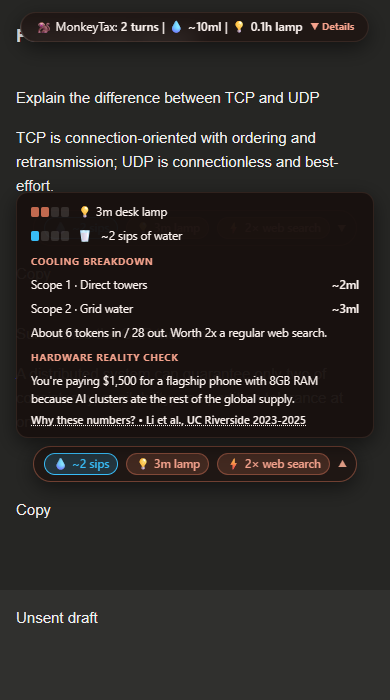

---

## 3. Thread-total dock: expandable dashboard + deep-history scanner

Opening a **pre-existing** conversation (`chatgpt.com/c/…`,
`gemini.google.com/app`, `claude.ai/chat/…`) mounts a translucent
dark-glass dock **pinned to the top center** showing
`🧵 Thread: N turns | 💧 ~Xml | 💡 Nh lamp | ▼ Details`.

Clicking **▼ Details** expands an interactive card: a 4-stat dashboard
(water with a mini bottle-fill icon, power + lamp hours, web-search
equivalence, microwave blast seconds below 20 Wh or continuous phone
screen-on time above it) plus a **⚡ Scan Entire History**
button. Chat apps virtualize their message lists, so only a window of
messages may exist in the DOM. The scanner moves upward in overlapping
viewport steps every 250 ms, retains observed totals by stable response
ID, rediscovers replaced scroll panels, and waits for three seconds of
quiet at the top. It leaves the chat at the top rather than restoring
the old scroll position. Its 60-second bound reports a limit instead of
claiming completion when loading has not settled. Gemini uses a seven-
second quiet window and re-arms its top-edge loader every 1.5 seconds.
Its Material spinner check requires the loader to intersect the chat
viewport, so an offscreen spinner cannot hold the scan open forever. The button reports
`✓ Thread Scanned (N loaded turns)`; unloaded or inaccessible history
cannot be guaranteed. The per-conversation ID cache resets on navigation
and prevents recycled message nodes from duplicating thread totals.
Discovering old messages does not create new daily receipts.

Gemini's append-only `infinite-scroller.chat-history` uses a separate
top-edge pagination retry: the scan reaches the top, waits for Material
history-loading spinners that intersect the chat viewport, and moves
beyond the top viewport before returning to trigger another page.
Offscreen spinners do not count as active loading. The longer quiet
window accommodates network pauses between page fetches. A
Gemini-specific regression keeps an offscreen spinner mounted and
requires three separately triggered pages to load from one scan-button
click without creating daily receipts. This final change was validated
in the local browser harness; the live Edge bridge timed out before the
updated code could be checked against the signed-in Gemini conversation.

Regression coverage includes three delayed history batches and a
14-message virtualized transcript on both Claude and ChatGPT. Each
single-click scan must retain all seven virtualized turns, finish at
scroll position zero, preserve unrelated sidebar position and inline
scroll styles, and leave daily prompt counts unchanged.

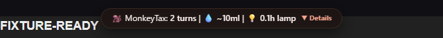

Expanded dashboard after a full-history sweep:

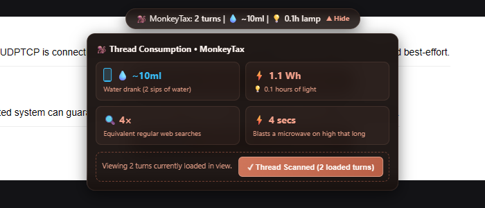

---

## 3.5 Adaptive theme engine (live dark ⇄ light)

The MonkeyTax brand palette uses terracotta `#C1694F` and soft peach
`#DF9B84`: roasted espresso surfaces in dark mode, warm cream surfaces
and espresso text in light mode. Water telemetry remains blue; roast
warnings remain red. Canonical `--mtx-*` tokens back the existing
`--ptx-*` aliases, preserving component and data-attribute compatibility.
The popup uses a local Twemoji PNG avatar and retains linked CC-BY 4.0
attribution after receipt updates. Toolbar icons are generated at
16/32/48/128 pixels with approximately 8% padding per side.

A theme detector (`src/content/ui/theme-detector.ts`) reads the **real
host page** — `dark`/`light` classes on `<html>`/`<body>`,
`data-theme`/`data-mode` attributes, inline `color-scheme`, background
luminance fallback, OS media query last — and a `MutationObserver` on
`<html>`/`<body>` (plus `matchMedia`) flips every mounted surface
**without a page reload**: badge pills, drawers, the thread dock, and
the citation modal all consume one CSS custom-property token set bound
to `:host([data-ptx-theme=…])`. Roast pills keep a dedicated
high-contrast red theme in *both* modes (dark: `#F87171` border;
light: `#EF4444` border on `#FEF2F2`). The captures below were produced
by toggling the fixture theme mid-session, and the harness asserts
every mounted host carries the flipped `data-ptx-theme` attribute.

Thread dock, light mode:

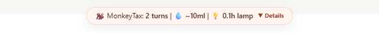

INFORMATIVE pill, light mode:

Drawer expanded, light mode:

Roast pill, light mode (contrast-preserving red tokens):

**Production markup support:** selectors target ChatGPT's current
`data-chatgpt-search-unit-key` values ending in `:user` / `:assistant`,
as well as the older `article[data-testid^="conversation-turn-"]` /
`.agent-turn` with `.markdown/.prose` bodies and the global
stop-button streaming gate; Claude `[data-testid="user-message"]` /
`.font-user-message` with backwards-walk user pairing; a generic
document-order user⇄response zipper (all three platforms) takes over
whenever an adapter's strict selectors see nothing after a redeploy.
Sidebar thread switches (SPA `pushState`, no reload) are caught by an
800 ms `location.href` watch that wipes processed-turn tracking,
re-seeds history, and rebuilds the dock after the new thread hydrates.

Live Edge testing on 2026-10-26 reproduced the old ChatGPT selector
failure and the scanner restoring a bottom scroll position on Claude.
The updated extension was exercised against signed-in conversations on
both sites, including real drawer clicks and sidebar navigation.
History badges are rendered explicitly rather than relying on whether
the initial page hydration happened before or after observer startup.
On the real 14-message Claude transcript, the virtualized scan retained
seven turns at scroll position zero even when only six assistant rows
remained mounted. A real ChatGPT scan also reached position zero in a
7,204-pixel conversation with three replies. Real conversation contents
and screenshots are not included in this fixture gallery.

---

## 4. Scientific citation modal

Opened via the **"Why these numbers? → Li et al., UC Riverside
2023–2025"** link inside the drawer. Renders the Scope 1 / Scope 2
split, the full citations (UC Riverside `arXiv:2304.03271` /
`arXiv:2506.07146`, Hugging Face 2024, IEA 2024), and the methodology
constants including the **~5× prefill-to-decode ratio**, the
2025/2026-calibrated coefficients (0.5 Wh base, 0.3/1.5 Wh per 1k
input/output tokens, 5.0 ml/Wh grid water), and the 2.0× reasoning
multiplier. The highlighted **"The Single Plastic Straw Effect"**
card answers *why do these numbers look small per prompt*: daily
accumulation (a 50-prompt session ≈ 1 liter of cooling water), the
zero-entropy target (mechanical waste like `"Thanks"`, not deep work),
and fleet-scale watershed impact. Dismisses on ×, backdrop, or `Escape`.

The **Global Macro Perspective** panel avoids stating an unaudited global
query count as fact. It presents 1 billion queries/day only as a
hypothetical scale scenario and explains that no audited cross-provider
daily counter is available.

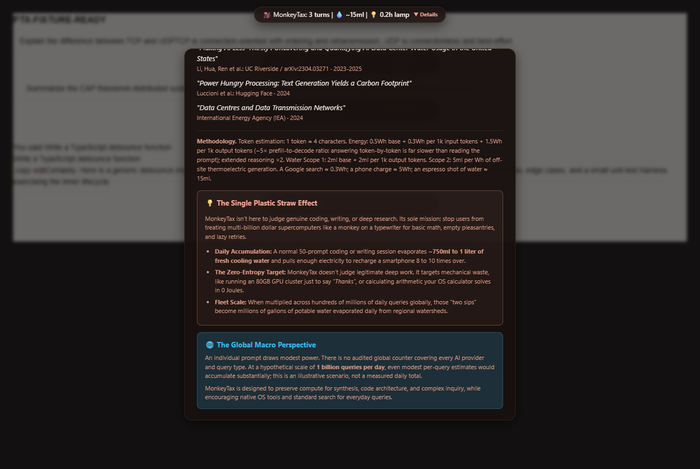

---

## 5. Per-platform rendering

One INFORMATIVE turn on each supported platform — identical centered
pill and metric chip everywhere; the platform adapters differ only in
their extraction selectors.

**Gemini:**

**ChatGPT:**

**Claude:**

---

## 6. Toolbar popup — session receipts

### 6.1 Populated

Rolling per-day and all-time aggregates written to `chrome.storage.local`
by the service worker: prompts taxed, cooling water (Scope 1 + 2), energy,
filler-tax count (politeness, greetings, lazy retries), and Google-search
equivalent. Manual thread scans persist once per platform/conversation
fingerprint; repeated clicks do not add the same thread twice. Existing
`days` storage migrates to `dailyHistory` while remaining mirrored for
compatibility. The receipt footer now speaks in the same
human visuals as the pills (`≈ a full reusable bottle`, not espresso
shots).
Under the daily grid, a contextual **Scale Reality Check** badge escalates
with volume: `🌱` under 10 prompts, `⚡` phone-charge equivalence at 10–29
(as pictured), or `🚰` water-bottle count at 30+.
At the top sits **🔄 Scan Active Chat Now**: it messages the content
script in the active tab (`PTX_FORCE_SCAN`), which force-scans every
pair currently in the DOM, injects badges on turns the live observer
never saw, and answers with the scanned totals
(`✓ Scanned N turns (Xml water, Y Wh)`). If the tab predates an
extension reload it self-heals via `chrome.scripting` injection, and
falls back to "Please refresh this tab once to activate MonkeyTax."

At 15 all-time prompts, **Your 365-Day Run-Rate** projects the user's
own average daily water and energy use across 365 days and active days.
It does not multiply the user's numbers by an arbitrary population factor.

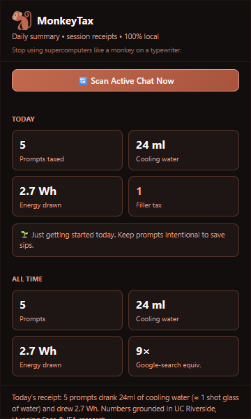

Annual run-rate at the 15-prompt threshold:

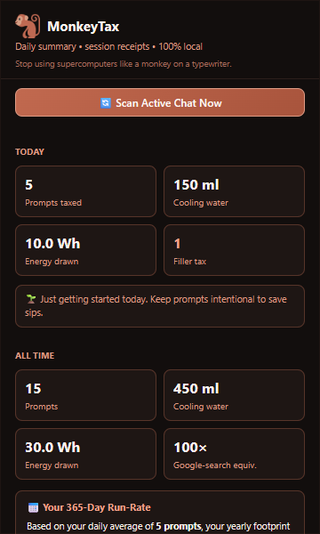

### 6.2 Zero state

Before any prompt has been recorded: zeroed stat grid and the
"no receipts yet" footer.

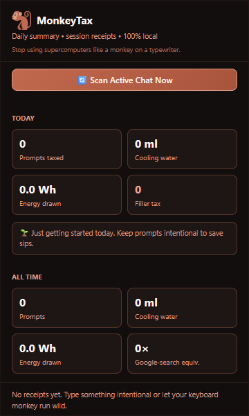

---

## 7. Multi-tier conversation overview

One Gemini thread: the seeded history folded into the top dock
(6 turns total), then four live turns — one per intent tier — each badge
centered under its own assistant response; roast tiers red, neutral
tiers terracotta with blue water telemetry.

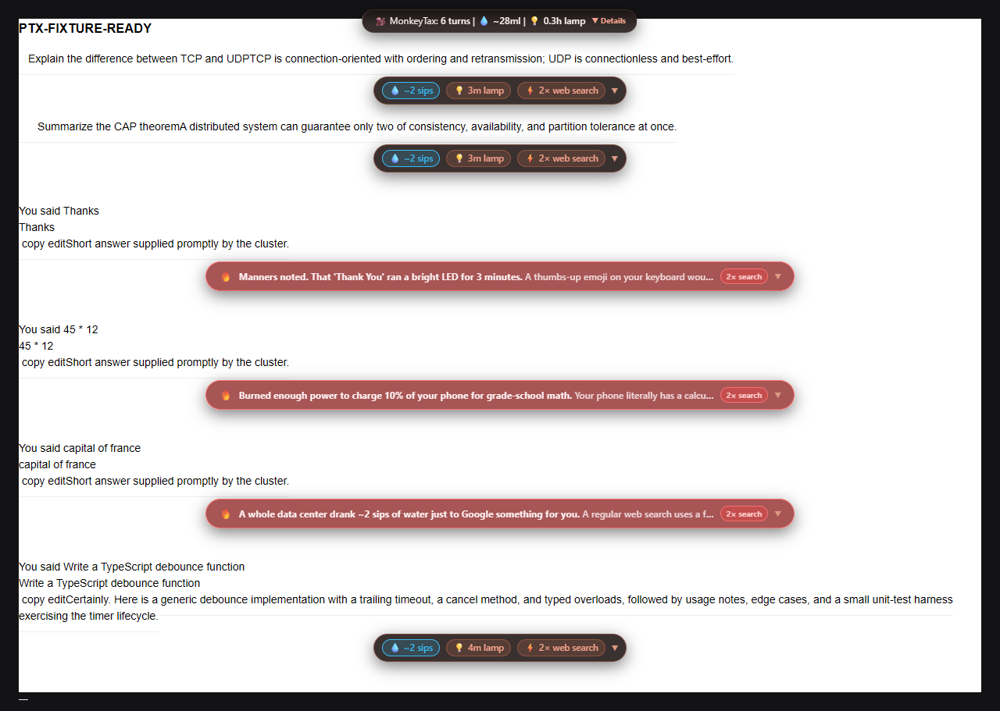

---

## 8. Pipeline behaviour proven by these captures

Each screenshot was taken only after the harness asserted the badge's
`data-ptx-tier` / `data-ptx-roast` attributes and the drawer's
`data-ptx-open` flag, and the thread dock's `data-ptx-turns` /
`data-ptx-water-ml` / `data-ptx-energy-wh` attributes per platform (the
sanctioned inspection surface — badges live in **closed** shadow roots
by design).

| Behaviour | Evidence |
|---|---|
| Output-weighted math (~5× prefill-to-decode; Scope 1 + Scope 2 water) | drawer screenshots §2, telemetry in `cases.json` |
| Gemini `You said X` accordion duplication collapsed | `sanitized: "Thanks"` telemetry line, every case |
| Leaked `copy edit` action labels + zero-width glyphs stripped | same telemetry line |
| Roast tiers never misfire on genuine work | 25-case false-positive matrix (`tests/classifier-edge-cases.spec.ts` + `scripts/test-edge-cases.mjs`, 25/25 green): "Thanks, now refactor this function…", "What is the time complexity of quicksort?", "Prove that 2 + 2 = 4 using Peano axioms", "Fix this TypeScript regex…", "Why is 0.1 + 0.2 !== 0.3 in JavaScript?" all stay `INFORMATIVE` |
| Full roast punchline visible on the COLLAPSED pill | `data-ptx-pill-chars >= 35` + `data-ptx-pill-theme="red"` asserted pre-click for every roast case; ellipsized tails always readable in the drawer (§2) |
| Scan button works under REAL mouse clicks | capture clicks the closed-shadow button at its published `data-ptx-scan-btn-rect` coordinates and asserts `data-ptx-scanned` matches `data-ptx-turns` |
| Badge fires only after streaming settles (800 ms quiet) | every screenshot shows final-length responses |
| Existing-chat scanning of pre-seeded history | §3 dock turn counts per platform |
| No double-counting between history scan and live turns | live assertion `turns = seeded + 1` per platform |
| Drawer toggle works on every platform | `data-ptx-open="true"` asserted before each §2 shot |
| Theme flips live, every surface | harness toggles `<html class>` mid-capture and asserts `data-ptx-theme` on **all** mounted hosts before every §3.5 shot |
| Expanded dock dismisses on outside click | capture-fold before subsequent badge clicks; `composedPath`-guarded document listener |

---

## 9. State matrix (completeness map)

| # | State | Tier / flag | Screenshot |
|---|---|---|---|
| 1 | Politeness filler (collapsed roast) | `POLITE` | §1.1 |
| 1b | Zero-question greeting | `GREETING` | §1.2 |
| 1c | Zero-context retry / rage-command | `LAZY_RETRY` | §1.3 |
| 2 | Trivial arithmetic, bare or natural-language (`what is 45 * 12`, `calculate 120/4`, `tell me how much is 7777+998`, `solve 9*9`, `45 times 12`, `what is 20% of 450`) | `SIMPLE_MATH` | §1.4 |
| 3 | Ultra-short lookup (`capital of france`, `weather in bengaluru`, `tokyo time`, `define ephemeral`) | `QUICK_SEARCH` | §1.5 |
| 4 | Genuine work, collapsed | `INFORMATIVE` | §1.6 |
| 5 | Genuine work + thinking ×2.0 | `INFORMATIVE` | §1.7 |
| 6 | Drawer expanded (segment meters + Reddit roast) | any | §2 (×3 platforms) |
| 7 | Thread dock pill on existing chat | — | §3 (×3 platforms) |
| 7b | Thread dashboard + deep scanner | — | §3 |
| 8 | Citation modal + Plastic Straw explainer | — | §4 |
| 9 | Centered rendering per platform | `INFORMATIVE` | §5 (×3) |
| 10 | Popup populated / zero (incl. manual Scan button) | — | §6 |
| 11 | Multi-tier thread + dock together | mixed | §7 |
| 12 | Dock + pill + drawer + roast pill in LIGHT theme | flipped live | §3.5 |

*Machine-readable run record: [`screenshots/cases.json`](screenshots/cases.json).*
